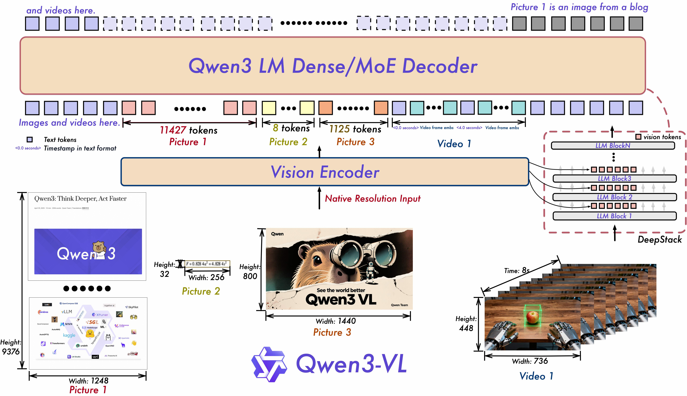

#  Qwen-VL distributed finetuning

- Running  full fine-tuning of a Qwen-VL model on ChartQA with FSDP2 (or DDP), with an accuracy check on held-out ChartQA test questions before and after training.
- I used a machine with 4xtitan RTX (24GB vRAM)

## About the scripts
###  Supervised Fine-Tuning (SFT):
The `sft_vl_lab` script does supervised fine-tuning (SFT) of the model (full parameter) on ChartQA, trained with next-token prediction on the answer tokens only. Each chart + question has one reference answer

  1. Loads a Qwen-VL Instruct model (Qwen3-VL or Qwen2.5-VL) in fp32.
  2. Freezes the vision encoder; the vision-to-language merger stays trainable. ```--train-vision``` trains everything.
  3. Distributes the model:
      - FSDP: every vision block and every language decoder layer becomes its own FSDP unit; the root unit holds the rest (embeddings, merger, final norm, lm_head).
      - DDP: a full copy on every GPU (runs out of memory for the 2B model on 24 GB GPUs, on purpose, as a comparison).
  4. Evaluates relaxed accuracy (the standard ChartQA metric) on test questions.
  5. Fine-tunes on train questions; the loss covers only the answer tokens (prompt, image tokens and padding are masked to -100).
  6. Evaluates again, appends a row to results_vl.csv, optionally saves the model.
  
Train and test splits are separate, so the before/after numbers are clean.

### grpo_vl_lab
TO DO

## Memory requirement
Precision fp32 + AdamW: ~16 bytes per trainable parameter, ~4 per frozen one:
  Qwen3-VL-2B  ~30 GB  : DDP runs out of memory on a 24 GB GPU; FSDP over 4 GPUs ~8 GB each
  Qwen3-VL-4B  ~66 GB  : FSDP ~17 GB each; needs --ac and --batch-size 1 and embedding layers freeze
  Qwen3-VL-8B  ~130 GB : doesn't fit on 4 x 24 GB without CPU offload; use LoRA instead
Every rank first loads the full fp32 model in CPU RAM (4 x 8.5 GB for 2B): check `free -g`.
I used Instruct models, Thinking models write long reasoning before the answer.

## Requirements

CPU + gloo also works (`torch.cuda.is_available()` is false), for debugging only.

| | |
|---|---|
| Python packages | `torch` with FSDP2 (`torch.distributed.fsdp.fully_shard`), `transformers` with Qwen3-VL support (4.57+), `datasets` |
| GPUs | Developed on 4 × NVIDIA TITAN RTX (24 GB). Runs in fp32 because this machine has no bf16 and fp16 would need loss scaling |
| CPU RAM | Every rank first loads the full fp32 model in CPU RAM: ~4 × 8.5 GB for the 2B model. Check `free -g` |


## Setup
Setup, once (download before launching so 4 processes don't download at the same time):
```bash
  hf download Qwen/Qwen3-VL-2B-Instruct --local-dir /mnt/ssd/models/Qwen3-VL-2B-Instruct
  hf download HuggingFaceM4/ChartQA --repo-type dataset --local-dir /mnt/ssd/data/ChartQA
  M=/mnt/ssd/models/Qwen3-VL-2B-Instruct
  D=/mnt/ssd/data/ChartQA
```
Use Instruct models: Thinking models write long reasoning before the answer, which doesn't fit the 16-token answer budget.
Recommended for every run, to reduce allocator fragmentation.

## Experiments
  1. Smoke test: 10 steps, small eval
  
        ```torchrun --nproc_per_node 4 sft_vl_lab.py --mode fsdp --model $M --data $D --max-steps 10 --eval-samples 40```

  2. DDP on the same model: expect out-of-memory at the first training step
  
        ``` torchrun --nproc_per_node 4 sft_vl_lab.py --mode ddp --model $M --data $D --skip-baseline --max-steps 5 ```

  3. The real run: baseline eval, 1 epoch on 2,000 examples, eval again, save
  
        ``` torchrun --nproc_per_node 4 sft_vl_lab.py --mode fsdp --model $M --data $D --save-dir /mnt/ssd/models/qwen3vl2b-chartqa ```

  4. Activation checkpointing: compare peak memory and speed with run 3
  
        ``` torchrun --nproc_per_node 4 sft_vl_lab.py --mode fsdp --model $M --data $D --ac --skip-baseline ```

  5. Also train the vision encoder
  
        ``` torchrun --nproc_per_node 4 sft_vl_lab.py --mode fsdp --model $M --data $D --train-vision --skip-baseline ```

  6. Bigger model
  
        ``` torchrun --nproc_per_node 4 sft_vl_lab.py --mode fsdp --model /mnt/ssd/models/Qwen3-VL-4B-Instruct --data $D --ac --batch-size 1 ```

Global batch = --batch-size × number of GPUs × --grad-accum. Changing the batch size changes the number of steps, so keep the learning rate in mind when comparing accuracy across batch sizes.


## Distributed training reminder
- The memory usage (during training) is due to storing:
    1. Model parameters (N)
    2. Optimizer state (in case of Adam, 2 values per parameter -> 2N)
    3. Gradients (N)
    4. Activations (depends on sequence length, batch size, hidden dimension, and number of heads )
- For the first 3 items:
    - in case of full precision (FP32): 4 x (N + 2N + N) = 16N; a model with 1B trainable params => 16GB needed, 4 bytes per param
    - in case of half precision (BF16): 16N total, model and gradients saved in FP16, Gradients in FP32, and we need an additional model instance in FP32
        - m_params: 2N
        - m_grad: 2N
        - m_params_fp32: 4N
        - m_opt: (4+4)N
    - Mixed precision does not reduced total of memory requirement, but distributes the memory differently across the three components, computing the forward/backward passes in half precision:
        1. allows us to use optimized lower precision operations on the GPU (faster compute)
        2. reduces the activation memory requirements during the forward pass

- For the activation memory reduction:
    - Gradient checkpointing (discard some activations during the forward pass to save memory and spend some extra compute to recompute these on the fly during the backward pass)
    - Gradient accumulation (slowing down training, as it is consecutive by nature)

## Memory

fp32 + AdamW needs ~16 bytes per trainable parameter (weights, gradients, two optimizer states) and ~4 bytes per frozen one, before activations:

| Model | Total | Fits on 4 × 24 GB? |
|---|---|---|
| Qwen3-VL-2B | ~30 GB | DDP: no. FSDP: ~8 GB per GPU of static memory |
| Qwen3-VL-4B | ~66 GB | FSDP: ~17 GB per GPU; needs `--ac` and `--batch-size 1` |
| Qwen3-VL-8B | ~130 GB | No, not without CPU offload; use LoRA instead (TO DO) |

On top of the static memory, activations grow with batch size and sequence length. Image tokens dominate the sequence, and batches are padded to the longest example, so the largest images in a batch decide the peak. The logits are a large share: the vocabulary is 151,936 tokens, so fp32 logits cost ~0.58 MiB per token at every position, while the loss only uses the few answer positions.


## Profiling using the script
You can ```--activation_measure``` and ```--mem-snapshot``` for memory profiling.

### mem-snapshot
Using ```torch.cuda.memory._dump_snapshot``` over 3 steps to profile. You can use ```https://docs.pytorch.org/memory_viz``` to visualize your traces.


## The learning paradigm
| Aspect | sft_vl_lab.py | Alternative |
|---|---|---|
| **Signal** | Supervised: each chart + question has one reference answer | RL (e.g. GRPO): the model generates answers and gets a reward |
| **Objective** | Next-token cross-entropy with teacher forcing: the model sees the correct previous tokens and predicts the next one | Preference losses (DPO), policy gradient |
| **Loss on** | Answer tokens only; the prompt and image are masked to -100 (completion-only loss) | Loss on every token, as in pretraining |
| **Parameters updated** | Full fine-tuning: language model + vision-to-language merger, vision encoder frozen (`--train-vision` unfreezes it) | Parameter-efficient (LoRA): small adapter matrices only |
| **Starting point** | An Instruct model, so this is task-specific SFT on top of existing instruction tuning | Base model |
| **Optimization** | AdamW, LR 1e-5, linear warmup then cosine decay, gradient clipping at 1.0, fp32 | bf16/fp16 mixed precision |


### Why teacher forcing is used?

Parallelism. Since every input is known in advance (the full reference sequence), all positions are predicted in one forward pass, using the causal attention mask so position t can’t see tokens after it. In your script that’s the single model(**batch) call: input ids, labels = the same ids, and the loss shifts them by one internally. Without teacher forcing, you’d have to generate token by token during training, as generate() does, which is much slower.

The downside is exposure bias; during training, the model never sees its own mistakes as input. At inference it does, and one wrong token can push it into situations it never trained on, so errors compound. That matters most for long outputs.
It also stabilizes learning. If the model’s own mistakes were fed back early in training, later positions would be trained on garbage prefixes.

TODO: RL methods like GRPO address this directly: the model generates its own sequences and learns from the reward on what it actually produced. That’s one reason SFT is often followed by RL.

## Troubleshooting

**`CUDACachingAllocator ... memory allocation failed with OOM` warnings while training continues.** These are warnings, not errors: an allocation failed, the allocator freed its cache and retried successfully. Typical requests are the root unit's gathered weights (~1.6 GB), the embedding/`lm_head` gradient (~1.2 GB) and the logits (variable size). They signal fragmentation near the memory limit and slow every rank down. Fixes: `PYTORCH_CUDA_ALLOC_CONF=expandable_segments:True`, a smaller batch, or `--ac`. Track `torch.cuda.memory_stats(device)["num_alloc_retries"]`; it should stay at 0.


### Model
Model: Qwen3-VL-2B-Instruct
Parameters: 2 Billion
Capabilities: Image understanding, OCR, visual reasoning, general conversation
Qwen3-VL adopts a three-module architecture:
- vision encoder
- MLP-based vision–language merger
- large language model (LLM)
<p align="center">
    
<p>
